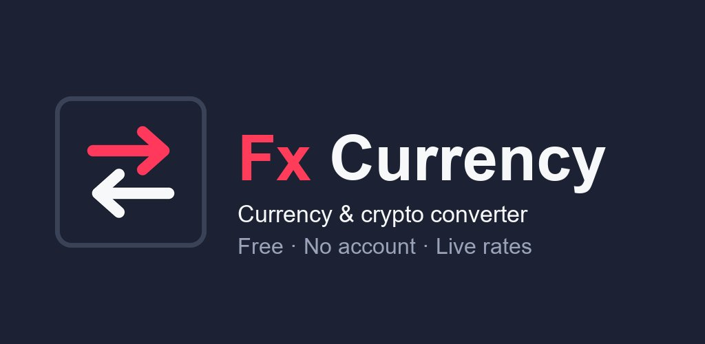
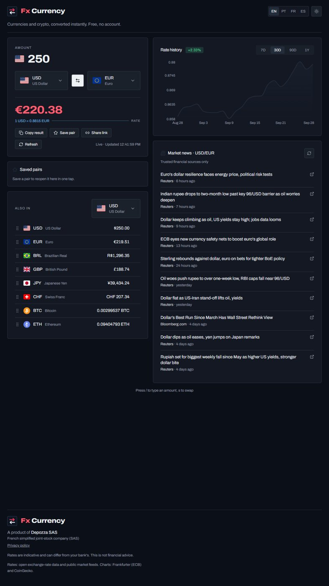
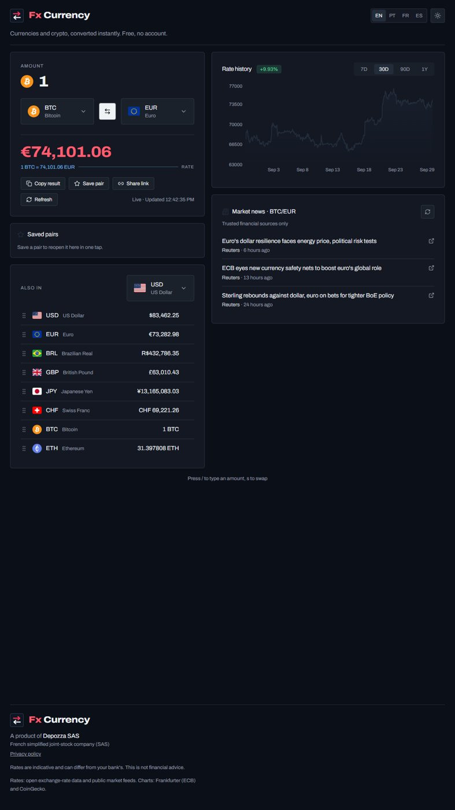

# FlashFX

Currency and crypto converter. Rates are kept on the device, so conversions still work offline.

**[flashfxcurrency.store](https://flashfxcurrency.store)** · Web, iOS and Android

## What it does

- Converts between world currencies and the main cryptocurrencies
- Rate history chart
- Works without a connection using the last saved rates

## Built with

TypeScript, React, TanStack Start, Capacitor.

The source code is private. This repository only holds the presentation.

---
A product of [Depozza SAS](https://depozza.com).
